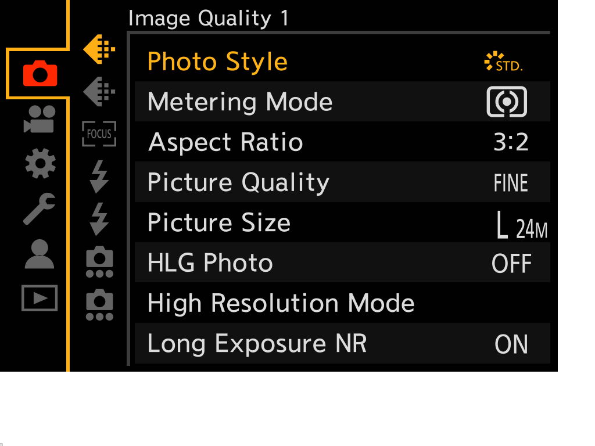

# Panasonic LUMIX S5：QEMU 与原厂界面研究

私有研究项目，进度快照：2026-11-25。

**完整交接版已补充为 [Full Handoff Release](https://github.com/Siegfried82/s5-qemu-research/releases/tag/handoff-full-20261125)。包含固件、完整工具链、所有内存快照与实验结果及外部依赖。请下载所有5个归档分片与校验/恢复附件；只点击 GitHub 的 Source code ZIP 不包含这些大文件。见[恢复与接手说明](handoff/HANDOFF.md)。

**已走通原厂时区/时钟开机向导、进入原厂取景 HUD，并真正渲染与交互导航 Panasonic LUMIX S5 原厂主菜单（照片与视频标签页、子列焦点切换、返回键退出），并提供一键本地浏览器交互入口。DSP、传感器/ISP、SD 卡槽和菜单快门到 JPEG 的整条硬件链尚未完成。**



## 当前结果

| 部分 | 已验证范围 |
| --- | --- |
| 多核 | 三个RTOS核心共享内存握手；第四核经原loader、mailbox和SGI启动原Linux |
| 外设 | 原RTC/SPI读写、定时器和GIC中断；部分外设采用明确标注的HLE或TEST输入 |
| 图形 | 原GUI产生文字轮廓、路径、图标、共享图像离屏绘制及实际EGL swap；软件后端在macOS绘制PNG |
| 模式切换 | 原模式35确认发出并消费，原状态机完成切换 |
| 输入 | 原厂 `0x06f1003c` 表中 19 个实体按键/拨轮经原pool、队列和处理器消费；新增 `key_sequence_scheduler` 在原 `eglSwapBuffers` 边界核对目标 `scene/modal` 门禁 |
| 外部硬件输入模型 | 全部默认关闭、单变量实跑对照通过：`--lens-release-input-high`（SPI3 `0x044e` bit0，解除 modal `0x4a`）、`--adc2-ch0-sample 0x3ff`（ADC2 ch0 方向电阻梯空闲，消除时区漂移）、`--adc0-ch5-sample 0x3ff`（ADC0 ch5 摇杆下空闲，消除 Clock Set 小时漂移）、`--shutter-s2-input-high` + `--adc1-ch4-sample 0x3ff`（机身快门 S2 与有线快门线未按，解除 Live View 进主菜单门禁） |
| 原厂主菜单与实时交互 | 已从开机向导走至原厂取景 HUD（`scene 0x1001`）与主菜单（照片 `scene 0x1002`、视频 `scene 0x10cd`）；新增 `interactive/s5_interactive.py` 浏览器交互入口（实测 `KEY_RIGHT`/`KEY_CENTER`/`KEY_DELETE`/`KEY_DOWN` 实时消费与画面刷新）、`viewer/s5_frame_viewer.py` 只读查看器与 `display/verify_trace_corpus.py` 轨迹回归工具 |
| JPEG局部实验 | 合成输入与真实LUT补丁、原JPU驱动及软件JPU模型可输出6000×4000 JPEG；尚非原相机快门/ISP整条链 |

“原厂界面”指固件真正执行并发出绘图调用；图形驱动由软件后端替代。当前仍用`--isolate-display`延迟未模拟的DSP等待，并局部运行原task66服务，以及显式测试中断。这些结果不表示整机已经完整启动。

## 下一步

1. 研究并建模 SD 卡槽（SDIO/存储控制器），解除取景界面“No memory card”提示并打通原厂存储读写链。
2. 推进快门/拍照控制链与未知协处理器（DSP，`0x7b000000`）研究，逐步替代显式 `--isolate-display` 与 TEST 脉冲。
3. 视需要合入任务 A（focused VFP 补丁）与任务 C（`replay_graphics_trace.patch`）的独立建议补丁并持续扩展图形轨迹回归集。

## 目录与证据

- [主工具说明](s5-emulator/README.md)、[最新多核菜单实验](s5-emulator/menu-smp/README.md)
- [交互式 S5 模拟器](s5-emulator/interactive/README.md)、[只读原厂画面查看器](s5-emulator/viewer/README.md)
- [QEMU板卡与设备源码](s5-emulator/qemu/)、[图形后端](s5-emulator/display/)
- [开机向导→取景HUD→主菜单报告](s5-emulator/qa/task-clock-menu/report.md)（[verification.json](s5-emulator/qa/task-clock-menu/verification.json)）
- [交互式模拟器端到端报告](s5-emulator/qa/task-interactive/report.md)（[verification.json](s5-emulator/qa/task-interactive/verification.json)）
- [时区漂移根因与单变量对照](s5-emulator/qa/task-timezone-drift/report.md)（[verification.json](s5-emulator/qa/task-timezone-drift/verification.json)）
- [任务A镜头输入对照](s5-emulator/qa/task-a/report-task-a.md)、[任务B连续按键调度](s5-emulator/qa/task-b/report-task-b.md)、[任务C图形重放验收](s5-emulator/qa/task-c/report-task-c.md)、[任务D只读查看器](s5-emulator/qa/task-d/report-task-d.md)
- [Gemini工作包](s5-emulator/gemini-work-packages/分工与验收.txt)、[快照文件与SHA-256](snapshot-manifest.json)

部分历史说明描述各阶段当时状态；以上进度与最新任务A结果优先。任务A比较器“不匹配已知警告PNG摘要”只能说明没有完全相同的警告图片，不能单独证明所有帧均无警告；本次结论同时依赖最终原状态、布局及图像检查。

## 本机继续运行

Git源码快照保留工程目录结构，但**源码ZIP不是完整交接包**。固件、48个组件、QEMU源码、完整构建环境和二进制已放入上述私有Release分片；恢复后仍需处理机器相关路径。

需在仓库根目录旁按现有程序约定准备：

```text
repo/
  s5-emulator/
  s5-v29-offline/               # 用户本地提供，不在Git中
    S5___V29.bin
    unpacked-v29/              # 原48个组件；每次启动核对摘要
```

原更新包SHA-256为`b2ec4aeec209693b874df8dfdf11fc85b38fa4675b44ec554b7a167f430827e1`。仅有实验BIN不足以启动此完整研究入口。

构建说明见[toolchain/README.md](s5-emulator/toolchain/README.md)。QEMU官方源码版本、下载地址和摘要在`toolchain/source-manifest.json`；需按记录恢复`toolchain/qemu-9.2.4/`及`toolchain/deps/`再运行`build.sh`，脚本应用项目板卡及定时器补丁。该快照没有自动下载安装依赖的引导器。图形后端当前依赖macOS CoreGraphics与Pillow；其他平台未验证。

在依赖与固件恢复后，从`s5-emulator/`一键启动本地浏览器交互式模拟器（默认自动走完向导进入原厂主菜单，也支持 `--boot-to liveview` / `--boot-to wizard`）：

```sh
python3 -B interactive/s5_interactive.py --boot-to menu --open-browser
```

或运行非交互单步对照命令：

```sh
python3 -B menu-smp/boot.py --ram 2G --storage-hle --capture-gfx --graphics-hle \
  --spi0-open-bus --spi6-open-bus --tx-serial-hle --adc11-sample 0x300 \
  --adc2-ch0-sample 0x3ff --adc0-ch5-sample 0x3ff --adc1-ch4-sample 0x3ff \
  --shutter-s2-input-high --lens-release-input-high \
  --isolate-display --isolate-display-ticks 600000 --linux-peer \
  --service-gui-once --probe-ui-mode35 --display-clock-test \
  --ui-service-loop --ui-service-postinit \
  --frame-irq-test-pairs 128 --frame-test-stage-seconds 10 \
  --lcd-refresh-test-pulses 12 --key-event KEY_CENTER --key-click \
  --seconds 120
```

以上外部输入开关均默认关闭，只改变对应外部硬件采样电平，不表示镜头已连接或整机已完整启动。QEMU需要宿主机允许JIT与本地调试套接字；不连接实体相机。

## 快照范围

保留项目源码、契约分析、验证脚本、选择的日志/JSON、原GUI实际提交PNG和一份软件JPU的JPEG结果。这些内容未放入Git提交；完整固件、组件BIN、RAM/SRAM转储、内核镜像、编译工具链、虚拟环境和全部重复实验已补入完整Release归档。某些图形重放依赖本机保留的二进制图像资产，因此仓库中部分轨迹只能作审计记录，不能保证独立重放。历史JSON内保留原本机路径作为证据，路径本身不会在新电脑自动生效。

本仓库是上传时的独立快照，原工作目录未被移动或更改；后续源码更新需要显式同步。`snapshot-manifest.json`记录复制时的源文件摘要，不包括本仓库新增的顶层说明文件。

## 代码来源

QEMU派生板卡及相关代码保留原文件头，适用其原有许可；见[QEMU-COPYING](QEMU-COPYING)。没有为原厂固件授予再分发许可，原固件不在本仓库。项目其它文件未统一另行授权。
