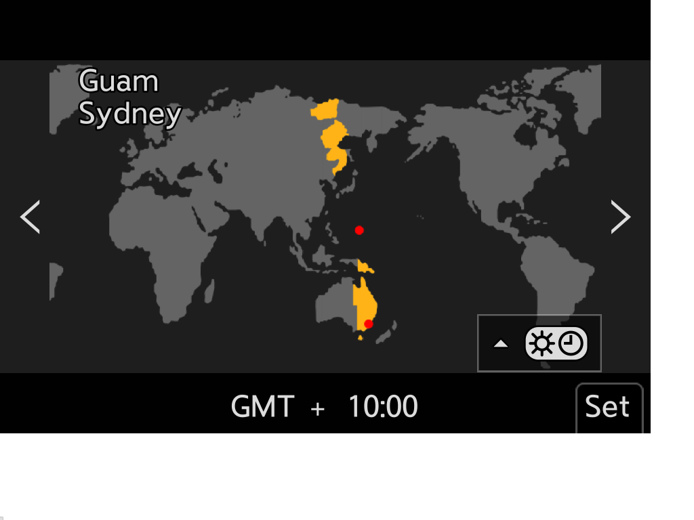

# Panasonic LUMIX S5：QEMU 与原厂界面研究

私有研究项目，进度快照：2026-11-25。

**已运行原厂时区选择界面，并通过原输入任务处理确认键。完整主菜单、DSP、传感器/ISP和菜单快门到JPEG的整条流程尚未完成。**



## 当前结果

| 部分 | 已验证范围 |
| --- | --- |
| 多核 | 三个RTOS核心共享内存握手；第四核经原loader、mailbox和SGI启动原Linux |
| 外设 | 原RTC/SPI读写、定时器和GIC中断；部分外设采用明确标注的HLE或TEST输入 |
| 图形 | 原GUI产生文字轮廓、路径、图标、共享图像离屏绘制及实际EGL swap；软件后端在macOS绘制PNG |
| 模式切换 | 原模式35确认发出并消费，原状态机完成切换 |
| 输入 | 原CENTER按下与释放经过原pool、队列和处理器；确认时区提示进入state0x20/scene0x70de |
| 最新镜头输入对照 | 默认输入复现modal0x4a；显式`--lens-release-input-high`后最终modal为0，实际显示无遮挡时区地图；425次绘制、10次swap |
| JPEG局部实验 | 合成输入与真实LUT补丁、原JPU驱动及软件JPU模型可输出6000×4000 JPEG；尚非原相机快门/ISP整条链 |

“原厂界面”指固件真正执行并发出绘图调用；图形驱动由软件后端替代。当前仍用`--isolate-display`延迟未模拟的DSP等待，并局部运行原task66服务，以及显式测试中断。这些结果不表示整机已经完整启动。

## 下一步

1. 定位时区没有方向键操作却持续向东变化的原因；方向键/拨轮输入异常目前只是候选解释。
2. 完善多步按键调度：新帧必须与期望scene/modal关联，再发送下一次确认。
3. 完成时区、日期设置，验证原主菜单导航。
4. 把真实画面查看和输入组织成持续交互入口，再继续DSP、图像和存储链。

Gemini任务A已产出独立测试与建议补丁。原focused测试缺少冷启动VFP使能；开启CPACR/FPEXC的独立测试通过，建议补丁保留在任务目录，未合入原测试。

## 目录与证据

- [主工具说明](s5-emulator/README.md)、[最新多核菜单实验](s5-emulator/menu-smp/README.md)
- [QEMU板卡与设备源码](s5-emulator/qemu/)、[图形后端](s5-emulator/display/)
- [任务A对照报告](s5-emulator/qa/task-a/report-task-a.md)、[机器可读结果](s5-emulator/qa/task-a/verification.json)
- [任务A默认输入结果](s5-emulator/qa/task-a/baseline-taska-02/result.json)、[释放输入结果](s5-emulator/qa/task-a/lens-release-high-taska-01/result.json)
- [Gemini工作包](s5-emulator/gemini-work-packages/分工与验收.txt)
- [快照文件与SHA-256](snapshot-manifest.json)

部分历史说明描述各阶段当时状态；以上进度与最新任务A结果优先。任务A比较器“不匹配已知警告PNG摘要”只能说明没有完全相同的警告图片，不能单独证明所有帧均无警告；本次结论同时依赖最终原状态、布局及图像检查。

## 本机继续运行

仓库保留工程目录结构，但**不是下载即运行的完整发行包**。原厂固件、48个解包组件、QEMU源码和构建依赖、本机编译器输出都未上传。

需在仓库根目录旁按现有程序约定准备：

```text
repo/
  s5-emulator/
  s5-v29-offline/               # 用户本地提供，不在Git中
    S5___V29.bin
    unpacked-v29/              # 原48个组件；每次启动核对摘要
```

原更新包SHA-256为`b2ec4aeec209693b874df8dfdf11fc85b38fa4675b44ec554b7a167f430827e1`。仅有实验BIN不足以启动此完整研究入口。

构建说明见[toolchain/README.md](s5-emulator/toolchain/README.md)。QEMU官方源码版本、下载地址和摘要在`toolchain/source-manifest.json`；需按记录恢复`toolchain/qemu-9.2.4/`及`toolchain/deps/`再运行`build.sh`，脚本应用项目板卡及定时器补丁。该快照没有自动下载安装依赖的引导器。图形后端当前依赖macOS CoreGraphics与Pillow；其他平台未验证。

在依赖与固件恢复后，从`s5-emulator/`运行：

```sh
python3 -B menu-smp/boot.py --ram 2G --storage-hle --capture-gfx --graphics-hle \
  --spi0-open-bus --spi6-open-bus --tx-serial-hle --adc11-sample 0x300 \
  --isolate-display --isolate-display-ticks 600000 --linux-peer \
  --service-gui-once --probe-ui-mode35 --display-clock-test \
  --ui-service-loop --ui-service-postinit \
  --frame-irq-test-pairs 128 --frame-test-stage-seconds 10 \
  --lcd-refresh-test-pulses 8 --key-event KEY_CENTER --key-click \
  --lens-release-input-high --seconds 120
```

该选项只改变串行外部输入位的读取电平，不表示镜头已连接。QEMU需要宿主机允许JIT与本地调试套接字；不连接实体相机。

## 快照范围

保留项目源码、契约分析、验证脚本、选择的日志/JSON、原GUI实际提交PNG和一份软件JPU的JPEG结果。未上传完整固件、组件BIN、RAM/SRAM转储、内核镜像、编译工具链、虚拟环境和大量重复实验。某些图形重放依赖本机保留的二进制图像资产，因此仓库中部分轨迹只能作审计记录，不能保证独立重放。历史JSON内保留原本机路径作为证据，路径本身不会在新电脑自动生效。

本仓库是上传时的独立快照，原工作目录未被移动或更改；后续源码更新需要显式同步。`snapshot-manifest.json`记录复制时的源文件摘要，不包括本仓库新增的顶层说明文件。

## 代码来源

QEMU派生板卡及相关代码保留原文件头，适用其原有许可；见[QEMU-COPYING](QEMU-COPYING)。没有为原厂固件授予再分发许可，原固件不在本仓库。项目其它文件未统一另行授权。
